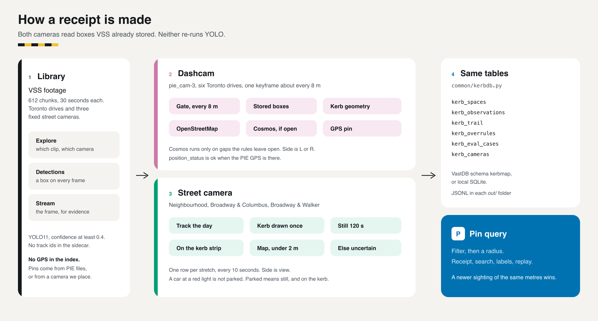
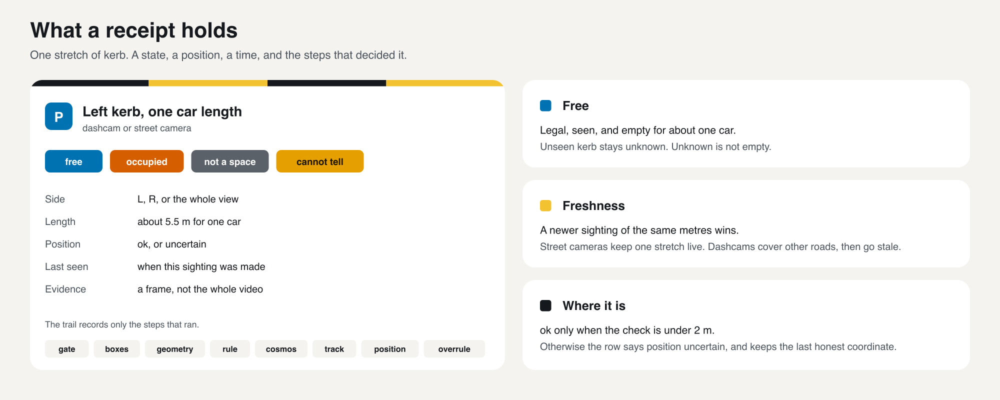
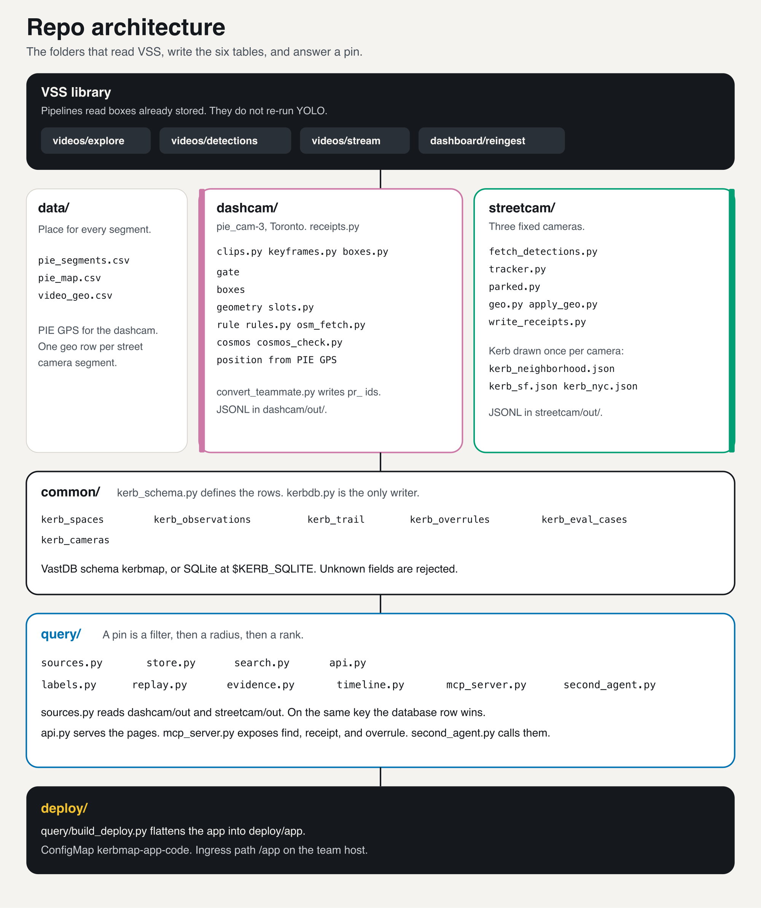

# Kerb Map

Where is the free kerb space, and how do we know? Kerb Map turns dashcam and street-camera footage into a map of
kerb space. Every stretch of kerb gets a **receipt**: free, occupied, not a space, or cannot tell; which side; when it
was last seen; an evidence frame; and the decision trail that produced the answer. Unseen kerb stays unknown.
Unknown is a different answer from empty.

**Live app:** open https://workshop.thecosmoslabs.com and click **App** (served at `/app` on the team host). Two
actions: **Set up my dashcam** (connect, upload a clip, processed automatically) and **Find parking** (mobile map,
nearest free spaces, receipt, evidence frame, "Why we think so", 👍/👎).

All footage is the organisers' supplied library (612 indexed chunks): the Toronto dashcam drives `pie_cam-3` (from
the public PIE dataset) and the street cameras `neighborhood_cam-1`, `sf_streets_cam-5` and `nyc_streets_cam-1`. No
outside video was ingested. Everything in this repo was built on the day by the four-person team.

The product sketch is [ONE-PAGER.md](ONE-PAGER.md), the build plan is [PLAN.md](PLAN.md), and agent rules are
[AGENTS.md](AGENTS.md).

## How it runs on the platform

```
dashcam clip --upload--> VAST storage
   --> VAST DataEngine: segmenter, YOLO11 boxes, NVIDIA Cosmos captions, Cosmos Embed1
   --> kerb analysis in the deployed app (kerbmap-app, team cluster):
         keyframe every ~8 m -> parked-car rows and gaps -> lane check -> OpenStreetMap rules
         -> Cosmos only on gaps the rules cannot settle -> position from GPS
   --> VastDB schema `kerbmap` (kerb_spaces, kerb_observations, kerb_trail, ...)
   --> app: Find parking (pin or street -> nearest free spaces + receipts)
```

The receipts on screen for the six Toronto drives were produced by the same pipeline run outside the cluster during
the build (`dashcam/receipts.py`) and loaded into VastDB; new uploads are processed in-cluster by the deployed app
(`query/upload.py`, `query/kerbpipe.py`, same steps and constants). The app's agent and its plain-language
explanations are being wired to W&B Serverless Inference; until then the tested agents run against the same API
(see Results and the tools below).

The team's architecture figures:





## Run it

Python 3.11 or newer, from the repo root. The committed JSONL is enough to open the map; no lab login is needed.

```bash
pip install -r query/requirements.txt
KERB_DB=local python -m query.api              # http://localhost:8000/
python -m pytest -q common/tests query/tests   # local backend only
KERB_DB=local python -m query.mcp_server       # MCP tools: find_free_space, get_receipt, overrule
```

On the lab VM, `KERB_DB=vastdb python -m query.api` reads schema `kerbmap` (credentials only from
`/config/<team>.config`, never printed or committed). The cluster deployment (ConfigMap + Secret + Deployment +
Ingress at `/app`) is in [query/DEPLOY.md](query/DEPLOY.md); the upload demo is in
`query/DEMO_UPLOAD.md` (branch `query/main`).

## Evaluation and agent tools

These live on branches of this repo and are not part of the app on `main`:

| Tool | What it does | Where |
|---|---|---|
| W&B Weave evaluation | Compares the kerb rules and the three label-driven rule changes against the human labels, per variant, tuning drives vs held-out drives | `weave_eval/` (branch `eval/weave`; `comparison.md`, `kerb_rules_eval.py`) |
| Second agent, local model | Answers the five questions in `query/agent_eval.md` with the MCP tools (`find_free_space`, `get_receipt`, `overrule`) | `query/second_agent.py` on `main`; live run `query/agent_run.py` (branch `query/second-agent`) |
| Second agent on W&B Inference | The same agent and tasks, with the model served by W&B Serverless Inference | `python -m query.agent_run --llm wandb --model <id> --base <app url>` (branch `query/second-agent`; key from `WANDB_API_KEY`, never committed) |

## Results (measured on the day; count beside every figure)

| What | Result | Source |
|---|---|---|
| Toronto dashcam processed | 1,080 segments x 5 s = 1.5 camera-hours, 6 drives | `dashcam/RESULTS.md` |
| Frames kept by the distance gate | 2,701 of 162,000 (1.67%) | `dashcam/RESULTS.md` |
| Dashcam receipts (`dc_`) | 5,110 from 7,846 sightings: 11 free, 1,710 occupied, 44 not a space, 3,345 cannot tell | `dashcam/RESULTS.md` |
| Second dashcam pipeline (`pr_`, pie-receipts) | 5,302 receipts | `dashcam/RESULTS.md` |
| Sightings sent to Cosmos | 4 of 7,846 (0.05%) | `dashcam/RESULTS.md` |
| Cosmos cost vs captioning every 5 s segment | 2.67 vs 720 calls per camera-hour: 270x fewer calls; 13.0 s vs 3,510 s of Cosmos time per camera-hour (4 uncached calls, 4.81-4.99 s each, on a team laptop) | `day-of` measured file |
| Clip to receipts, one 30 s clip | 0.23 s measured from stored detections; about 6.4 s estimated with detection fetch and one Cosmos call | `day-of` measured file |
| Why "cannot tell" | 5,482 of 5,516 cannot-tell sightings are "lane unclear": a car that might be in a traffic lane is never guessed as parked | `day-of` measured file |
| Dashcam labels, live receipts (shipped rules) | 120 labels from 2 people on sampled spots (all 108 spots answered). Main pipeline (`dc_`, 81 spots with a human answer): free right 7 of 11, occupied right 11 of 16, real kerb space right 18 of 27. Where it said "cannot tell", people said not a space for 26 spots and occupied for 5. pie-receipts pipeline (`pr_`, 17 spots): free 3 of 6, occupied 0 of 3, real kerb space 3 of 9. The two people agreed on 6 of 8 shared spots | `day-of/label-batches-dashcam/summary.txt` |
| Label-driven rule changes, held-out drives set04-06 (25 spots, rules chosen on set01-03) | With the three changes (shorter gap 0.85, travel-lane row, OSM no-parking side): free right 5 of 6 vs 4 of 5 with shipped rules; real kerb space right 7 of 8 vs 6 of 9. Not yet loaded into the live receipts | `weave_eval/comparison.md` (branch `eval/weave`), `RULES-FROM-LABELS.md` |
| Street camera labels | 100 labels from 3 people. Neighbourhood camera, held-out batches A1/A2/A4: 45 of 51 agree | `streetcam/out/eval_heldout.json` |
| Street-camera receipts | neighbourhood 308 (82 occupied, 226 free); New York 360 (278 occupied, 79 free, 3 cannot tell) | `streetcam/PROGRESS.md` |
| Agent on live data | Local agent (gemma4:e4b via Ollama) over the MCP tools: 5 of 5 tasks match data read straight from the API, including "cannot tell" for central London and a stored overrule | `query/out/agent_run.md` (branch `query/second-agent`) |
| Stock video search, for contrast | "free parking space at the kerb" on stock captions: none of 5 target chunks in the top 15 | `day-of` re-ingest record |

## What was built on the day, by workstream

| Workstream | Built |
|---|---|
| Dashcam, main pipeline (`dashcam/`, space ids `dc_`) | Distance gate, kerb rows and gaps from stored YOLO11 boxes, lane check, OpenStreetMap rules, Cosmos on unclear gaps only, GPS position, receipts. Rule study against labels on branch `dashcam/cannot-tell` |
| Dashcam, pie-receipts pipeline (branch `dashcam/pie-receipts`, space ids `pr_`) | A second dashcam pipeline written today by one teammate, converted into the same tables |
| Street cameras (`streetcam/`) | Tracker, position-based parked rule, hand-drawn kerb strips, homography to OpenStreetMap, plate-blurred evidence, receipts for three cameras |
| App and query (`query/`, `common/`) | Table contract and VastDB client, API, mobile "Find parking" and "Set up my dashcam", upload-and-process job, labelling batches, MCP tools and agents, Kubernetes deployment |
| Design (`design/`, deck) | Screens, architecture figures, slides |

## Honest limits

- **Few free spaces.** 11 of 5,110 dashcam receipts are free. A single drive-by sees parked cars far more reliably
  than a legal empty gap; street cameras watch one kerb for minutes.
- **Dashcam labels are sampled, not random** (all frees and not-a-spaces plus a spread of the rest), 120 labels from
  2 people, so recall is recall on that sample. The two people agreed on 6 of 8 shared spots; both disagreements are
  free vs not a space. The rule comparison rests on about 25 held-out spots: one spot moves a cell a lot.
- **Most dashcam answers are "cannot tell"** (3,345 of 5,110 receipts), mostly cars on the left of two-way roads
  where an oncoming lane may sit between us and the kerb.
- **San Francisco camera held back.** Its homography check is 20.84 m and a spot check found free receipts with a car
  in the strip, so its 90 rows are kept out of the app (`streetcam/out/sf/held_back/`).
- **New York positions are uncertain.** The held-out map check is 3.33 m against a 2 m bar; rows stay `uncertain`.
  The neighbourhood camera has no latitude/longitude.
- **Pin error is not measured.** Dashcam pins use an uncalibrated focal length and carry an along-road error of
  several metres.
- Cosmos timings are from a team laptop; the event endpoint's per-call time is not measured.

## Architecture

Both pipelines read boxes that VSS already stored (YOLO11, confidence at least 0.4, no track ids). They do not re-run YOLO. They write the same tables through `common/kerbdb.py`. The app reads those tables, and falls back to the JSONL files the builders committed under `dashcam/out/` and `streetcam/out/`.



A free space is a legal stretch a camera actually saw, empty for about one car length (5.5 m). A newer sighting of the same metres wins. Street cameras keep one stretch fresh. Dashcams cover other roads, then go stale. Dashcam `position_status` is `ok` when the keyframe has PIE GPS. Street-camera `position_status` is `ok` only when the held-out homography check is under 2 m.

### Dashcam (`pie_cam-3`, Toronto PIE)

`dashcam/receipts.py` is the pipeline. For each drive `set01`–`set06`:

1. **gate** — one keyframe about every 8 m, using speed and distance in `data/pie_segments.csv`.
2. **boxes** — car, truck, and bus boxes from the stored sidecar, in the original 1920×1080 frame.
3. **geometry** — left and right kerb rows, a lane check, and gaps between parked cars.
4. **rule** — OpenStreetMap junctions, driveways, crossings, signals, hydrants, and bus stops.
5. **cosmos** — only the gaps the rules leave open. The local Cosmos-Reason server returns one word and a confidence.
6. **position** — GPS at the keyframe time, plus a forward and side offset. `position_status` is `ok` when that GPS is present.
7. **write** — `kerb_spaces`, `kerb_observations`, and `kerb_trail` through `common/kerbdb.py`, and JSONL under `dashcam/out/`.

Counts and the assumptions behind them are in [dashcam/RESULTS.md](dashcam/RESULTS.md). A second dashcam pipeline, built today by one teammate (pie-receipts, [dashcam/PROGRESS.md](dashcam/PROGRESS.md)), is converted into the same tables by `dashcam/convert_teammate.py` (space ids prefixed `pr_`). The two pipelines are reported separately.

### Street cameras

Three fixed cameras. The kerb is drawn once, on one frame, in `kerb_neighborhood.json`, `kerb_sf.json`, and `kerb_nyc.json`.

| Camera | What the drawing is | How a window is written |
|---|---|---|
| `neighborhood_cam-1` | Near strip between the driveways, far strip, lane, two driveways. No lat/lon in `data/video_geo.csv`. | One row per stretch per 10 s. Occupied when a parked period covers the stretch. An empty window is `free` with reason `no parked car on the hand-marked legal stretch`. |
| `sf_streets_cam-5` | Broadway & Columbus (Condor Club in view). Landmark is about ±75 m, not the camera. | Same 10 s windows. Legality is unknown, so an empty window is `free` with reason exactly `legality unknown`. |
| `nyc_streets_cam-1` | Broadway & Walker St (401 Broadway in view). Same landmark class. | Same as San Francisco. |

`streetcam/tracker.py` links boxes with greedy IoU against a constant-velocity prediction, and keeps a track open for 2 s so it crosses segments. `streetcam/parked.py` is the occupancy rule. On the neighbourhood camera a kerb strip is cut into cells of about 1 m. A cell is occupied in a 120 s window when a vehicle on that strip covers it in at least 60% of frames. Tracks that flicker are stitched (30 px, 3 s) before that test. On San Francisco and New York the same 120 s test found no parked track: vehicles break into shorter tracks, so those receipts are the empty-window rows above.

`streetcam/geo.py` fits a homography from image pixels on the road to OpenStreetMap nodes, in local east/north metres. `position_status` is `ok` only when the held-out check is under 2 m. San Francisco’s check is 20.84 m, so those rows stay on the Condor Club point. New York’s check is 3.33 m, so the projected curb is written and the status stays `uncertain`. The neighbourhood camera has no latitude, so its rows have null `lat`/`lon`. The second New York measurement is in `streetcam/out/geo_nyc_refine.json`. The full log is [streetcam/PROGRESS.md](streetcam/PROGRESS.md).

### Query

`query/api.py` serves the pages in `query/static/` and the JSON API. `query/store.py` reads the database. `query/sources.py` loads JSONL from `dashcam/out/` and `streetcam/out/` (or `KERB_JSONL_DIRS`). On the same key the database row wins. A bad JSONL line is skipped and counted on `GET /api/health`. `query/mcp_server.py` exposes find, receipt, and overrule. `query/second_agent.py` calls those tools for the five questions in `query/agent_eval.md`.

A pin query is a filter (state, side, source) plus a radius (`spaces_near`). Search then ranks those rows by cosine similarity. The embedder is Cosmos Embed1; `KERB_EMBEDDER=hash` is a test stand-in and is labelled as such in every response. Spaces with no lat/lon of their own are placed at their camera’s `kerb_cameras` position.

## The tables

Defined in `common/kerb_schema.py`. `common/kerbdb.py` rejects unknown fields and enum values before a write. Times are ISO-8601 UTC. `embedding` is 256 floats or null. `detail_json` is a JSON string.

| Table | One row is |
|---|---|
| `kerb_spaces` | One kerb stretch: `free`, `occupied`, `not_space`, or `cannot_tell`; side `L`, `R`, or `view`; position `ok` or `uncertain`; last seen; evidence; receipt text. |
| `kerb_observations` | One sighting of that stretch. |
| `kerb_trail` | One decision step: `gate`, `boxes`, `geometry`, `rule`, `cosmos`, `track`, `position`, `overrule`. |
| `kerb_overrules` | A person or agent correction, and which receipts it changed. |
| `kerb_eval_cases` | A frozen label (`dev` or `heldout`) and its sha256. |
| `kerb_cameras` | One camera: kind, place, `geo_source` (`pie_gps`, `landmark_estimate`, `refined`, `unknown`), and the homography check error. |

VastDB uses schema `kerbmap` in the team bucket (`KERB_VDB_SCHEMA` overrides it). The VSS collection tables are never written. Locally the file is `$KERB_SQLITE` or `~/kerb-data/kerb.sqlite`.

## Folders

| Path | What it is |
|---|---|
| [`common/`](common/README.md) | The table contract and the only database client. Tests in `common/tests/`. |
| [`dashcam/`](dashcam/RESULTS.md) | Builder A. Toronto PIE pipeline: clip list, keyframes, boxes, slots, OSM rules, Cosmos, receipts. `out/` holds the JSONL, evidence JPEGs, and per-set work files. |
| [`streetcam/`](streetcam/PROGRESS.md) | Builder B. Tracking, the parked rule, receipts, and the map fit for `neighborhood_cam-1`, `sf_streets_cam-5`, and `nyc_streets_cam-1`. `day-*/` holds per-camera tracks. `out/` holds receipts, timelines, and the geo fit. `frame_*.jpg` are the frames the kerb was drawn on. |
| [`query/`](query/README.md) | Builder C. API, map and receipt pages, labelling, replay, and MCP tools. |
| [`data/`](data/README.md) | GPS and place attached to every segment we use. `pie_map.csv` and `pie_segments.csv` are PIE’s own GPS, matched frame by frame. `video_geo.csv` is one row per segment for the dashcam and the three street cameras. |
| [`design/`](design/README.md) | Prototype mock data for slides. It does not feed the app. |
| [`deploy/`](query/DEPLOY.md) | Kubernetes manifest `k8s/kerbmap-app.yaml`. `query/build_deploy.py` writes a flat `deploy/app/` for the ConfigMap. Applied: `kerbmap-app` runs on the team cluster at `/app` (workshop App button). |

Pages in `query/static/` (relative URLs only; `api.js` is the only file that calls the server):

| Page | What |
|---|---|
| `index.html` | Home: set up a dashcam, or find parking. |
| `setup.html` | How a dashcam syncs into the map. |
| `find.html` | Map. Pin, radius, and the receipts nearby. |
| `explore.html` | Same map with the receipt list. |
| `label.html` | Claim a batch and label a moment. |
| `board.html` | Labelling progress. |
| `measured.html` | Results of a measurement run. Empty until `GET /api/measured` has a file. |

## Getting started

Commands run from the repo root. Python 3.11 or newer.

The committed JSONL is enough to open the map. No lab login is required.

```bash
pip install -r query/requirements.txt
KERB_DB=local python -m query.api
```

Then open [http://localhost:8000/](http://localhost:8000/). Useful calls:

| Call | What |
|---|---|
| `GET /api/health` | Backend name, row counts, which JSONL files loaded. |
| `GET /api/spaces?lat=43.68&lon=-79.42&radius_m=500` | Receipts near a pin. |
| `GET /api/receipt/{space_id}` | Space, ordered trail, observations, camera, evidence. |
| `GET /api/search?q=free+kerb&lat=43.68&lon=-79.42` | Filter, then cosine rank. |
| `POST /api/overrule` | Body `{"space_id", "new_state", "note", "by"}`. |

Five synthetic rows, local SQLite only:

```bash
KERB_DB=local python -m query.seed_local
```

Tests (local backend only):

```bash
python -m pytest -q common/tests query/tests
```

MCP tools `find_free_space`, `get_receipt`, and `overrule`, over stdio. The five tasks, including an abstention, are in [query/agent_eval.md](query/agent_eval.md).

```bash
KERB_DB=local python -m query.mcp_server
```

### On a lab VM

Credentials live only in `/config/<team>.config`. Source them in your own shell. Do not print, log, or commit them. GitHub’s port 22 is blocked on the VM; use port 443.

```bash
KERB_DB=vastdb python -m query.api          # schema kerbmap; unset KERB_DB does this when /config/*.config exists
```

The real VastDB and Cosmos Embed1 check is [query/SMOKE_TEST.md](query/SMOKE_TEST.md). Deploy and update steps are [query/DEPLOY.md](query/DEPLOY.md). Rehearse first:

```bash
bash query/rehearse_deploy.sh
```

Dashcam receipts need the detection cache, OSM cache, and frames outside this repo (`DASHCAM_DATA`, default path in `dashcam/receipts.py`):

```bash
python dashcam/receipts.py slots set04
python dashcam/receipts.py cosmos set04      # needs the local Cosmos server and frames
python dashcam/receipts.py write set04
```

Street-camera tracks need a detection cache from `streetcam/fetch_detections.py`, which logs into VSS. The parked rule and the map fit then run offline:

```bash
python streetcam/parked.py --kerb streetcam/kerb_neighborhood.json \
  --tracks streetcam/day-20260901/tracks.jsonl streetcam/day-20260902/tracks.jsonl \
  --out streetcam/out/occupancy_timeline.jsonl
python streetcam/geo.py                  # self-test
python streetcam/geo.py streetcam/geo_nyc.json   # print the fit; does not write receipts
```

`streetcam/apply_geo.py` copies a fit onto `kerb_spaces` and appends a `position` trail step. It rewrites the spaces file you pass it and appends to the trail file on every run. The files in `streetcam/out/` already have that step, so leave them unless you are rebuilding receipts from scratch:

```bash
python streetcam/apply_geo.py \
  streetcam/out/kerb_spaces.jsonl streetcam/out/kerb_trail.jsonl streetcam/out \
  streetcam/geo_sf.json streetcam/geo_nyc.json
```

## Where the numbers are

Every figure in a slide should come from one of these files, with its count beside it.

| File | What it records |
|---|---|
| [dashcam/RESULTS.md](dashcam/RESULTS.md) | The `receipts.py` run: slots, states, Cosmos share, time per stage. Label results: day-of label summary. |
| [dashcam/PROGRESS.md](dashcam/PROGRESS.md) | The pie-receipts pipeline: clips, boxes and Cosmos. |
| [streetcam/PROGRESS.md](streetcam/PROGRESS.md) | Tracks, occupancy, receipts, and both homography passes. |
| `streetcam/out/eval_labels.json` | Neighbourhood agreement on the labels that were open while the occupancy rule was fixed. That is development-set agreement. |
| `streetcam/out/eval_heldout.json` | The held-out batches read once after that fix. |
| `GET /api/measured` | The query measurement file, when someone writes it. The page is empty until then. |

## How we work

One branch per workstream: `dashcam/…`, `streetcam/…`, `query/…`, `design/…`. Small commits. A person reviews before anything lands on `main`.

Do not invent numbers, labels, or positions. Do not edit frozen labels. Do not re-ingest hours of video without the team agreeing. Do not ingest video from the internet. Cosmos runs only on gaps the cheaper steps could not settle.

Receipt crops must not show faces or number plates. Street-camera evidence frames blur plate regions. Store the intervals and the receipts. Raw video stays only as long as the library already keeps it.

## Credits

Footage: organisers' supplied library. Toronto drives from the PIE dataset (York University, MIT licence). Map data ©
OpenStreetMap contributors (ODbL). Ultralytics YOLO11 (AGPL-3.0). NVIDIA Cosmos (captions, Cosmos-Reason, Cosmos
Embed1). VAST Data platform (storage, DataEngine, VastDB, cluster). Weights & Biases (Serverless Inference, Weave).
Built with Cursor. Street names and the kerb reference nodes are © OpenStreetMap contributors.
